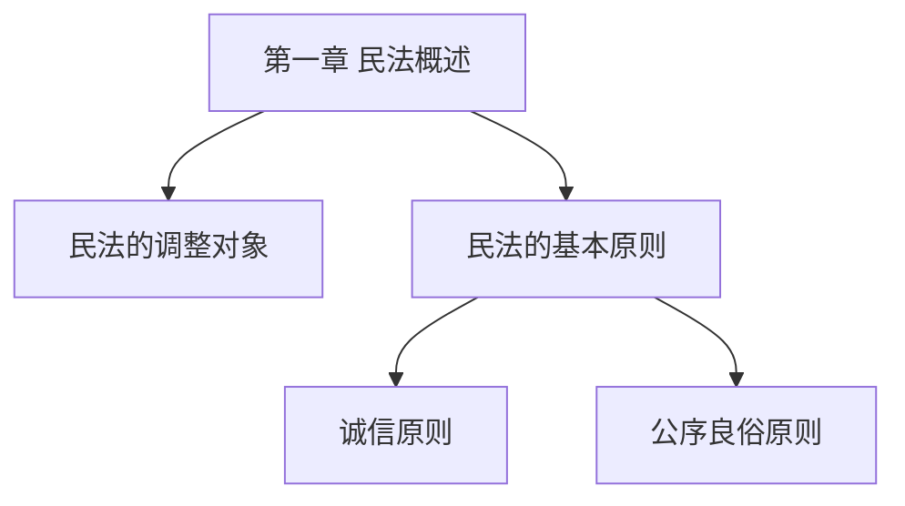

# 知识管理：课程资料、知识体系与进度

本文件展开 SKILL.md §4、§5 的细节：如何接收资料、如何把资料变成可测试的知识点、如何维护索引与进度。所有规则的前提是：**不修改原件、不虚构内容、不让用户数据进入公共模块。**

## 1. 工作区结构

```
law-study-workspace/
├── profile/
│   ├── learner-profile.md    # 学习者自述：基础、偏好、可用时间
│   └── goals.md              # 学习目标：课程目标、考试/应用目标、时间表
├── materials/                # 原始资料，只读
│   └── <course-slug>/        # 教材、课件、大纲、笔记
├── courses/
│   └── <course-slug>/
│       ├── course.md         # 课程配置（教材、大纲、目标、资料来源）
│       ├── progress.md       # 章节进度与掌握统计
│       ├── knowledge/
│       │   ├── index.md      # 知识点索引（只登记位置与状态）
│       │   └── <topic>.md    # 一个知识点一个文件
│       └── notes/
│           ├── questions.md  # 疑问与待确认事项
│           ├── summaries/    # 章节总结
│           └── derived/      # 从 PPT/PDF 导出的文本（保留原文件名映射）
├── review/
│   ├── plan.md               # 复习策略与节奏
│   └── queue.md              # 复习队列
├── diagnostics/
│   └── gaps.md               # 薄弱点档案
├── log/
│   ├── learning-log.md       # 追加式学习日志
│   └── sessions/             # 每次会话摘要
└── .backup/                  # 覆盖前备份
```

`<course-slug>` 用小写英文与连字符，例如 `civil-law`、`criminal-law`、`constitutional-law`。显示名称写在 `course.md` 里，不用中文目录名。

## 2. 资料清单

建课时先登记资料，不读正文也可以完成：

| 字段 | 说明 | 示例 |
| --- | --- | --- |
| 文件名 | 原始文件名，不改写 | `第一章 民法概述.pptx` |
| 类型 | 教材/课件/大纲/笔记/案例/其他 | 课件 |
| 版本或日期 | 用户能提供的最新信息 | 2026 秋季版 |
| 页数/篇幅 | 便于估时与定位 | 74 页 |
| 可读性 | 文本 / 需转换 / 扫描模糊 | 文本 |
| 处理状态 | 未读 / 已读 / 已导出 / 待确认 | 已导出 |
| 存放位置 | 工作区相对路径 | `materials/civil-law/` |

规则：

- 只登记用户实际提供的资料，不补写“应该还有”的教材。
- 教材写清**书名、作者、版次、出版社、出版年**；缺项写“用户未提供”，不猜。
- 课件标注“教师课件，版权归原权利人”，只做摘要与引用，不整篇复制。
- 无法读取的扫描件、图表、公式段落单独列“待人工确认”。

## 3. 内容提取与派生文件

1. 文本、Markdown、可复制文本：直接读，逐段对照页码。
2. PPT/PDF：优先用宿主已有能力只读提取；需要额外工具时先说明工具名、安装方式、处理范围与风险，经用户同意后再执行。
3. 图片/扫描页：需要 OCR 时同样先确认；OCR 结果必须标注“OCR 结果，可能有误”，并保留页码。
4. 派生文件命名：`notes/derived/<原名>_提取文本.md`，开头写来源文件、提取方式、页数、提取日期、已知缺失。
5. 提取结果不得直接当作核验过的知识：未经与原件比对的内容，`status` 为 `待验证`。

派生文件头部示例：

```markdown
> 来源文件：materials/civil-law/第一章 民法概述.pptx
> 提取方式：宿主内置文本读取（未使用第三方转换工具）
> 页数：74 页；缺失：第 12、31 页为图片，未提取
> 提取日期：2026-11-10
> 状态：原始文本，未做知识化处理，引用前需回看原件
```

## 4. 课程配置（course.md）

用 [../templates/course-template.md](../templates/course-template.md) 生成，必须能回答六个问题：

1. 教什么：教材、版次、课程范围、学分/学时。
2. 教到哪：章节结构、覆盖范围、未覆盖部分。
3. 学到什么程度：学习目标与考核方式。
4. 用什么资料：每类资料的名称、位置、核验状态。
5. 怎么验证：本课程适用的核验方法与评估方式。
6. 边界在哪：不包含的内容、待确认事项。

不同学科可在模板基础上增加字段，但不得删掉“教材及版本”“资料来源”“学习目标”“章节结构”。

## 5. 知识点的原子化标准

一个知识点应满足：

- **单一判断**：能用一句话说清它主张什么。
- **可测试**：能出至少一道题检验，且答案不依赖其他未学知识。
- **可定位**：能指到具体章节，最好能指到资料页码。
- **可关联**：能说出至少一个前置或对照概念。

不合格的信号：标题是“概述”“基本原则”“相关问题”这类整章级主题；正文超过两屏仍在换主题；同一文件里塞了三个互不相关的规定。

拆分示例（教学设计，非教材内容）：

```text
主题：合同的订立
├── 要约的构成
├── 要约与要约邀请的区分
├── 承诺的构成
├── 承诺生效与合同成立
└── 格式条款的订入控制
```

“合同的订立”保留为主题节点，只放地图与索引；具体条目各自成文件。

## 6. 知识点条目格式

文件名用 `<章节序号>-<短名>.md`，例如 `03-02-要约的构成.md`。frontmatter：

```yaml
---
id: civil-03-02
title: 要约的构成
course: civil-law
chapter: 第三章 合同的订立
level: 理解            # 记忆 | 理解 | 辨析 | 应用
prerequisites:
  - civil-03-01
related:
  - civil-03-04
contrasts:
  - civil-03-03        # 要约邀请
sources:
  - type: 课程资料
    cite: 第三章课件 p.8-11
    status: 已核验
  - type: 权威规范
    cite: 《中华人民共和国民法典》合同编相关条文（具体条号待核验）
    status: 待验证
mastery:
  记忆: 已掌握
  理解: 待复测
  辨析: 未测试
  应用: 未测试
updated: 2026-11-10
---
```

正文固定结构（可裁剪，不可缺“来源”与“证据”）：

```markdown
## 核心内容
（用自己的话准确复述，不整段抄教材）

## 要素与要件
| 要件 | 含义 | 判断要点 |
| --- | --- | --- |

## 辨析
| 对比项 | A | B |
| --- | --- | --- |

## 例证
- 正例：
- 反例：
- 边界例：

## 常见错误
-

## 检测问题
1.

## 证据记录
| 日期 | 层次 | 题目/任务 | 表现 | 结论 |
| --- | --- | --- | --- | --- |
```

规则：

- `sources` 至少一条；确实没有来源时写 `type: 待补`、`status: 待验证`，并在正文说明缺什么。
- `mastery` 四层分别记录，不得用一个“掌握/未掌握”概括。
- `level` 表示本条目的**最高目标层次**，检测时仍按四层分别记。
- 正文用自己的话；直接引用不超过必要长度，并标注出处。
- 更新时保留旧证据行，不删除历史。

## 7. 关系类型与建网方法

| 关系 | 含义 | 用途 |
| --- | --- | --- |
| 前置 | 不学 A 难以理解 B | 排学习顺序、诊断“原理不清” |
| 包含 | A 是 B 的下位类型 | 建树、避免重复建条目 |
| 并列 | 同一层级、同一标准下的分类 | 建分类表、出分类题 |
| 对照 | 易混、需要区分 | 出辨析题、做对比表 |
| 例外 | B 是 A 的例外或限制 | 出边界题、防过度概括 |
| 适用 | 规则如何落到事实 | 案例涵摄 |
| 流程 | 有时间或程序顺序 | 诉讼、程序类课程 |

建网步骤：

1. 先按章节建树（包含/并列），保证结构完整。
2. 再补前置关系，形成学习顺序。
3. 最后补对照与例外，这两类决定辨析与案例能力。
4. 每新增一个条目，至少连一条边；孤立节点必须处理（补关系或合并）。
5. 跨章节关系只连“确实影响理解”的，不为了好看强行连。

跨章关联的判定问题：

- 学 B 时会不会用到 A 的结论？会 → 前置。
- A 与 B 是否常在同一道题里出现且容易混？是 → 对照。
- B 是否是 A 的一般规则之外的特别情形？是 → 例外。
- A、B 是否属于同一分类标准下的不同类？是 → 并列。

## 8. 索引与地图

`knowledge/index.md` 只放导航，不放正文：

````markdown
# 知识索引 · 民法学

> 只登记位置与状态；正文在各条目文件中。

## 章节地图


## 条目表
| id | 名称 | 文件 | 层次 | 掌握（记/理/辨/用） | 最近复测 |
| --- | --- | --- | --- | --- | --- |
| civil-01-01 | 民法的调整对象 | `01-01-调整对象.md` | 理解 | 已/待/未/未 | 2026-11-08 |
````

规则：

- 条目表与文件必须一一对应；改名或合并时同步更新索引。
- 掌握状态用单字缩写（已/待/未/学），与条目 frontmatter 一致。
- 地图超过 20 个节点时按章拆分，避免一张图不可读。

## 9. 进度文件（progress.md）

```markdown
# 学习进度 · 民法学

- 整体进度：3/12 章
- 最近学习：2026-11-10
- 当前章节：第三章 合同的订立
- 下次建议：3.2 要约与承诺

## 章节进度
| 章节 | 状态 | 条目数 | 已掌握(记/理/辨/用) | 最近学习 | 备注 |
| --- | --- | --- | --- | --- | --- |
| 第一章 | 需回补 | 12 | 10/7/4/2 | 2026-11-05 | 辨析层待补 |
| 第二章 | 进行中 | 9 | 4/2/0/0 | 2026-11-10 | 案例未开始 |

## 待办与疑问
-

## 变更记录
| 时间 | 修改内容 | 原因/依据 | 备份位置 |
| --- | --- | --- | --- |
```

状态取值：`未开始`、`进行中`、`已完成`、`需回补`。只有该章所有条目在目标层次上都有通过证据，才能标“已完成”；否则标“进行中”或“需回补”。

## 10. 质量检查清单

每次建课或大批量补条目后自检：

- [ ] 每个条目都有来源字段，且 `status` 与实际情况一致。
- [ ] 没有孤立节点。
- [ ] 没有两个文件讲同一知识点（重复条目）。
- [ ] 章节范围与大纲一致，未覆盖部分已标注。
- [ ] 索引与文件一一对应。
- [ ] 掌握状态都有证据行支撑。
- [ ] 提取文本与原件页码能对上，缺失页已标记。
- [ ] 没有大段复制教材/课件原文。
- [ ] 没有把个人数据写进课程文件。

## 11. 变更与备份

- 修改 `course.md`、`progress.md`、`index.md` 前，复制旧版到 `.backup/<YYYYMMDD-HHmmss>/`，并在“变更记录”写原因。
- 学习日志与会话摘要只追加，不重写历史。
- 发现写错：保留错误版本，追加一条更正记录，说明原错误与更正依据；不无痕删除。
- 同一文件被两次会话改出冲突：保留两个版本，标记“待复核”，报告用户，不按修改时间武断取舍。

## 12. 课程模块与内核分离

- 本文件属于**内核**：任何法学课程都用同一套流程与字段。
- 课程差异只写进 `course.md`：教材、章节、评估方式、课程专属工作流。
- 新增课程不改本文件；若某课程需要新字段，先在 `course.md` 的“扩展字段”中声明，验证有效后再考虑是否上升为通用字段。
- 公共课程模块只放结构与公开资料索引，不放个人笔记、成绩、薄弱点。
