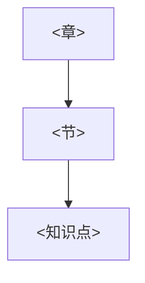

# 课程模板

> 用法：复制本文件为 `courses/<course-slug>/course.md`，替换 `<...>` 占位内容。
> 只填写用户实际提供的信息；不确定的写“待确认”，不要留空，也不要猜。
> 本模板是**结构**，不包含任何教材内容。

---

# 课程配置 · `<课程名称>`

## 1. 基本信息

| 字段 | 值 |
| --- | --- |
| 课程名称 | `<例如：民法学>` |
| 课程 slug | `<例如：civil-law>` |
| 学科 | `<例如：法学>` |
| 学校 / 院系 | `<待确认>` |
| 学期 / 学年 | `<待确认>` |
| 学分 / 学时 | `<待确认>` |
| 授课教师 | `<待确认>` |
| 课程类型 | `<必修 / 选修 / 自学 / 备考>` |
| 当前状态 | `<未开始 / 进行中 / 已完成>` |
| 建立日期 | `<YYYY-MM-DD>` |
| 最近更新 | `<YYYY-MM-DD>` |

## 2. 教材及版本

| 字段 | 值 |
| --- | --- |
| 教材名称 | `<书名>` |
| 作者 / 主编 | `<作者>` |
| 出版社 | `<出版社>` |
| 版次 | `<第 X 版>` |
| 出版年 | `<YYYY>` |
| ISBN | `<用户提供则填，否则写“用户未提供”>` |
| 使用范围 | `<全书 / 指定章节>` |
| 备注 | `<例如：课程实际以课件为主，教材为参考>` |

参考书目（没有则写“暂无”）：

| 名称 | 作者 | 版次 | 用途 |
| --- | --- | --- | --- |
|  |  |  |  |

## 3. 课程大纲

> 来源：`<大纲文件名 / 教师口述 / 用户整理>`；下方为课程要求覆盖的范围，不等同于教材目录。

| 周次 / 单元 | 主题 | 对应章节 | 学时 | 备注 |
| --- | --- | --- | --- | --- |
| 1 |  |  |  |  |
| 2 |  |  |  |  |

未覆盖或待确认部分：

- `<例如：第 9 周内容大纲缺失，待用户补充>`

## 4. 章节结构

> 层级：编/章 → 节 → 知识点主题。只写结构，正文放知识点文件。

```text
<课程名称>
├── 第一编 <编名>
│   ├── 第一章 <章名>
│   │   ├── 第一节 <节名>
│   │   │   ├── <知识点主题 1>
│   │   │   └── <知识点主题 2>
│   │   └── 第二节 <节名>
│   └── 第二章 <章名>
└── 第二编 <编名>
```

覆盖状态：

| 章节 | 资料是否齐全 | 已建条目数 | 状态 |
| --- | --- | --- | --- |
| 第一章 | 是 | 0 | 未开始 |

## 5. 核心知识点

> 一行一个知识点；详细内容写入 `knowledge/<topic>.md`，此处只做总览。
> 层次：记忆 / 理解 / 辨析 / 应用（取本课程要求的最高层次）。

| id | 知识点 | 所属章节 | 目标层次 | 前置 | 对照概念 | 来源 | 核验状态 | 掌握状态 |
| --- | --- | --- | --- | --- | --- | --- | --- | --- |
| `<slug>-01-01` |  |  |  |  |  |  | 待验证 | 未测试 |

## 6. 知识点关联

> 至少标出前置与对照关系；跨章关系只连确实影响理解的。

| 起点 | 关系 | 终点 | 说明 |
| --- | --- | --- | --- |
|  | 前置 / 对照 / 例外 / 适用 / 包含 / 并列 / 流程 |  |  |

章节级地图（可选，节点多时按章拆分）：



## 7. 资料来源

| 类型 | 名称 | 版本 / 日期 | 存放位置 | 可读性 | 核验状态 | 备注 |
| --- | --- | --- | --- | --- | --- | --- |
| 课程大纲 |  |  | `materials/<slug>/` | 文本 | 待验证 |  |
| 教材 |  |  |  |  | 待验证 | 仅登记书目，未复制内容 |
| 课件 |  |  |  |  | 待验证 | 版权归原权利人 |
| 课堂笔记 |  |  |  |  | 待验证 |  |
| 案例 |  |  |  |  | 待验证 |  |

资料规则：

- `materials/` 下只读，任何加工另存到 `notes/derived/`。
- 每条资料注明能证明什么、不能证明什么。
- 未授权资料不进入公开仓库。

## 8. 学习目标

> 目标要可检验；避免“学好民法”这类无法判断的表述。

| 层级 | 目标 | 检验方式 | 期限 |
| --- | --- | --- | --- |
| 课程目标 | `<例如：能对给定案例完成要件涵摄>` | `<案例题，按四项评分>` | `<YYYY-MM-DD>` |
| 章节目标 |  |  |  |
| 本次目标 |  |  |  |

学习约束：

- 每周可用时间：`<n> 小时`
- 偏好：`<先例子后概念 / 先框架后细节 / 其他>`
- 考试形式：`<闭卷 / 开卷 / 论文 / 无考试>`

## 9. 评估方式

| 评估项 | 占比 | 形式 | 备注 |
| --- | --- | --- | --- |
| 平时 |  |  |  |
| 期末 |  |  |  |

本课程适用的核验方法：

- 现行规范：`<需要核对哪些法规 / 数据库>`
- 课程口径：`<以课件还是教材为准>`
- 案例：`<是否需要核对裁判文书>`

## 10. 课程扩展字段

> 不同学科可在此声明专属字段；确认有效后再考虑上升为通用字段。

| 字段 | 值 | 说明 |
| --- | --- | --- |
| 知识结构类型 | `<概念 / 规范 / 要件 / 法律效果 / 案例>` |  |
| 专属评估方式 |  |  |

## 11. 待确认事项

- [ ] `<教材版次待确认>`
- [ ] `<大纲第 9 周缺失>`

## 12. 变更记录

| 时间 | 修改内容 | 原因 / 依据 | 备份位置 |
| --- | --- | --- | --- |
| `<YYYY-MM-DD HH:mm>` |  |  |  |
